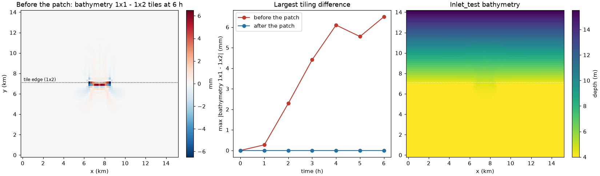

# roms-sed-morph-tiling.patch: sediment morphology results depended on the MPI tiling

| | |
|---|---|
| **Type** | fix |
| **Changes results?** | yes, for runs with `SED_MORPH` on more than one ROMS tile; one-tile runs are bit-identical to stock |
| **Default** | on (all lines inside `SEDIMENT` + `SED_MORPH`, `DISTRIBUTE`, or `SED_WENO` code) |
| **Files** | `ROMS/Nonlinear/step2d_LF_AM3.h` (`h_halo_fast_steps`), `ROMS/Nonlinear/Sediment/sed_bed.F` (`bed_thick_halo`), `ROMS/Nonlinear/Sediment/sed_bedload_vandera.F` (`weno_stencil_reach`) |
| **Evidence** | Inlet_test: ROMS on 1x1 and 1x2 tiles differ by 6.5 mm in bathymetry after 6 h (12 mm after 12 h) stock; bit-identical with the patch, in every variable and record |
| **Test** | [`tests/fixes/roms-sed-morph-tiling/run.sh`](../../../../tests/fixes/roms-sed-morph-tiling/run.sh), see its [README](../../../../tests/fixes/roms-sed-morph-tiling/README.md) |
| **Upstream** | not yet reported to COAWST |

## In short

A parallel ocean model must give the same answer whether it runs on 1
processor or 100. With sediment morphology switched on (`SED_MORPH`: the bed,
and therefore the water depth, changes as sand moves), COAWST v3.9 did not:
COAWST's own Inlet_test gave a different bathymetry on 2 processors than on 1,
by 6.5 mm after 6 hours and 12 mm after 12, concentrated exactly along the line
where the grid is split between processors. Three places in the code forgot
to keep the border copies of a field up to date, or read border values that
were never computed. With the three fixes, 1 and 2 processors give
bit-for-bit identical results.

| Change | What was wrong | Where |
|---|---|---|
| `h_halo_fast_steps` | the depth `h` changes every barotropic step, but its border copies were refreshed only after all of them | `step2d_LF_AM3.h` |
| `bed_thick_halo` | the bed thickness was never refreshed in the borders between processors | `sed_bed.F` |
| `weno_stencil_reach` | the bedload scheme read fluxes one point further out than it had computed | `sed_bedload_vandera.F` |

## Background: tiles, halos, and why results should not depend on them

ROMS runs in parallel by cutting the horizontal grid into rectangular tiles,
`NtileI x NtileJ`, one per MPI process. Each process computes only its own
tile, but most calculations at a point need its neighbours (a flux across a
cell face needs the cells on both sides). So each tile carries a border of
2 or 3 extra rows and columns, the "halo" or "ghost points", holding copies
of the neighbouring tiles' values:

```
   tile A (process 0)                 tile B (process 1)
   ... own points ... | halo copy of B | halo copy of A | ... own points ...
                      <---- tile edge ---->
```

After any step that changes a field, the processes exchange their edge rows
(`mp_exchange2d`/`mp_exchange3d`; `exchange_r2d_tile` does the same for
periodic boundaries within one tile) so that every halo again holds the
neighbour's current values. If an exchange is missing, a tile computes with
its neighbour's old values; if a loop reads further into the halo than was
filled, it computes with whatever is in memory. Either way, points near a tile
edge get a different answer than with one tile, and the difference depends on
where the edges are, i.e. on the number of processes.

A model that is correct in this respect is bit-reproducible across tilings:
1x1 and 1x2 give the same numbers to the last bit. That is a strong and
cheap test, because any missing exchange shows up as a difference at the
tile edge.

**Why it matters:** results that depend on the number of processors cannot be
reproduced on another machine or with another layout, so a run cannot be
checked by repeating it; and in morphology the error accumulates: the bed
keeps the memory of every step.

## h_halo_fast_steps: the depth was stale in the halo during the fast steps

ROMS splits time into baroclinic steps (DT, e.g. 60 s), each subdivided into
NDTFAST barotropic ("fast") steps for the depth-averaged flow and sea level.
With `SED_MORPH`, `step2d_LF_AM3.h` adds the bed change to the depth `h` at
every fast step, but only on the tile's own points (`Istr:Iend`,
`Jstr:Jend`). The halo copies of `h` were refreshed only by `set_depth`,
after all the fast steps of the baroclinic step. In between, every flux
across a tile edge used the neighbour's depth from the start of the
baroclinic step.

**The fix** exchanges `h` together with the sea level `zeta`, in the exchange
that already follows the sea-level update at every fast step (and in the
periodic exchange for one tile):

```fortran
#ifdef DISTRIBUTE
# if defined SEDIMENT && defined SED_MORPH
!
!  Also exchange the bed-updated "h": the fast time steps use it in the
!  halo before the next call to "set_depth" exchanges it.
!
      CALL mp_exchange2d (ng, tile, iNLM, 2,                            &
     &                    LBi, UBi, LBj, UBj,                           &
     &                    NghostPoints,                                 &
     &                    EWperiodic(ng), NSperiodic(ng),               &
     &                    zeta(:,:,knew), h)
# else
      CALL mp_exchange2d (ng, tile, iNLM, 1,                            &
     &                    LBi, UBi, LBj, UBj,                           &
     &                    NghostPoints,                                 &
     &                    EWperiodic(ng), NSperiodic(ng),               &
     &                    zeta(:,:,knew))
# endif
#endif
```

Without `SED_MORPH`, `h` does not change during the fast steps and the code is
exactly as before.

## bed_thick_halo: the bed thickness was never exchanged between processes

`sed_bed.F` recomputes the bed-layer thickness `bed_thick(:,:,nnew)` and
`bed_thick(:,:,3)` after erosion and deposition, on the tile's own points. The
code refreshed them for periodic boundaries (`bc_r3d_tile`) but had no
exchange between MPI processes. With MPDATA tracer advection (Inlet_test's
sand uses it), `step3d_t.F` reads both in the halo (`IstrUm2:Iendp2i`), so the
advection of suspended sand near a tile edge used the neighbour's bed thickness
from an earlier step.

**The fix** adds the missing exchange right after they are computed:

```fortran
#  ifdef DISTRIBUTE
      CALL mp_exchange2d (ng, tile, iNLM, 2,                            &
     &                    LBi, UBi, LBj, UBj,                           &
     &                    NghostPoints,                                 &
     &                    EWperiodic(ng), NSperiodic(ng),               &
     &                    bed_thick(:,:,nnew), bed_thick(:,:,3))
#  endif
```

## weno_stencil_reach: the bedload scheme read values it had not computed

The Van der A bedload formula (`sed_bedload_vandera.F`) computes a sediment
flux in each cell (`FX_r`, `FE_r`) and then the flux through each cell face
with a WENO scheme (`SED_WENO`, hard-coded on in that file), a
high-order upwind interpolation that uses three cells on each side of the
face. The face flux at the tile's last face (`Iend+1`, `Jend+1`) therefore
needs cell fluxes up to `Iend+3`, `Jend+3`. But the loops that compute them
stopped at `Iendp2i`/`Jendp2i`, two points out:

```fortran
 # if defined SED_WENO
-      DO j=Jstrm3,Jendp2i
-        DO i=Istrm3,Iendp2i
+!  The WENO stencil of the last face (Iend+1, Jend+1) reaches FX_r and
+!  FE_r at Iend+3 and Jend+3, so compute them that far.
+      DO j=Jstrm3,Jendp3
+        DO i=Istrm3,Iendp3
```

(and the same in the second loop). The stencil then read whatever was in
memory at the third point. It matters only when the upwind side of the last
face is the far side, i.e. when sand moves towards the tile from outside; in
Inlet_test that first happened after 3.4 h (step 204, rows 35/36), when sand
at the tile edge started moving south. `Iendp3` is three points out inside the
domain and clipped to the boundary row at a domain edge, so no array is read
out of bounds.

## How the bugs were found

Inlet_test with 1 SWAN process and ROMS history at every step: find the first
step and place where 1x1 and 1x2 tiles differ; rebuild with options switched
off to see which one causes it (`SED_MORPH` off removed every difference;
bedload off, or `-ffp-contract=off` to rule out fused multiply-add, did not);
then print every input of the bedload face flux at the two cells that first
differed. The inputs matched but the face flux did not, which led to the
stencil reach. The two halo exchanges were found by reading the code for every
field `SED_MORPH` changes.

## How the test works

`tests/fixes/roms-sed-morph-tiling/run.sh` ([README](../../../../tests/fixes/roms-sed-morph-tiling/README.md))
builds COAWST's stock Inlet_test before and after the patch and runs each for
6 h with ROMS on one tile (1x1) and on two (1x2), with 1 SWAN process. Inlet_test
has `SED_MORPH`, Van der A bedload and MPDATA sand, so all three bugs are
exercised, and the 1x2 split puts the tile edge across the inlet, where the
sand moves. It then compares the last history record of 1x1 against 1x2:

- before the patch the two must differ (the bug);
- after it they must be bit-identical;
- and the 1x1 run after the patch must be bit-identical to the 1x1 run before
  it (on one tile there are no tile edges, so the patch must change nothing).

## Engine test results

Run 2026-10-30 on the control VM (4 vCPUs): stock Inlet_test (COAWST 26e6fb7,
compiler flags as shipped, `-O3 -ffast-math`), 6 simulated hours, 1 SWAN
process, ROMS on 1x1 and 1x2 tiles; "before" is stock COAWST (this was the
first patch of the series), "after" adds this patch. PASS.

**Before the patch: the two tilings differ**, growing with time, at the tile
edge (largest differences at rows 33-37; the 1x2 split is between rows 35 and
36):

| Variable | max \|1x1 - 1x2\| at 6 h | largest value |
|---|---|---|
| bathymetry `bath` | 6.5 mm | 15.5 m |
| bed thickness | 6.6 mm | 10.1 m |
| sea level `zeta` | 0.20 mm | 0.43 m |
| depth-mean current `vbar` | 1.5 mm/s | 1.9 m/s |
| current `v` | 1.6 mm/s | 2.0 m/s |

Bathymetry difference by hour: 0, 0.27, 2.3, 4.4, 6.1, 5.5, 6.5 mm (0-6 h).

**After the patch: 1x1 and 1x2 bit-identical** in `bath`, `zeta`, `ubar`,
`vbar`, `u`, `v`, `bed_thickness`, every record. **One tile, before vs after:
bit-identical.** No cost of the patch was measurable (12 h on 1x2 ROMS +
6 SWAN: 172 s patched, 174 s unpatched, 2026-10-20).



*Left: bathymetry on 1x1 tiles minus 1x2 tiles after 6 h, before the patch;
the difference sits on the tile edge (dotted) in the inlet, where sand moves.
Middle: the largest difference against time, before (red) and after (blue,
zero at every hour). Right: Inlet_test's depth. Made by
`tests/fixes/roms-sed-morph-tiling/plot_tiling.py`.*

## Who is affected

Any run with `SEDIMENT` and `SED_MORPH` on more than one ROMS tile;
`bed_thick_halo` matters with MPDATA tracer advection, `weno_stencil_reach`
with Van der A bedload. Runs on one tile are unchanged.

## Limits: what is still tiling-dependent or not covered

- **Splits in i (2x1, 2x2) still differ at rounding level.** A
  one-rounding-unit difference in `u_wec_stress` at the tile edge (i = 38)
  appears from step 13, with or without fused multiply-add. After 12 h,
  bathymetry differs by 1e-6 m and sea level by 1.5e-8 m (stock: 12 mm and
  0.17 mm). It first shows in the wave-current terms
  (`ROMS/Nonlinear/WEC/wec_vf.F`); not traced further. Splits in j only (1xN)
  are bit-identical.
- **The same omissions in other bed models are not patched** (not used by
  Inlet_test): `sed_bed2.F` and `sed_bed_cohesive.F` (`NONCOHESIVE_BED2`,
  `COHESIVE_BED`, `MIXED_BED`) also never exchange `bed_thick(:,:,nnew)` under
  MPI and never set `bed_thick(:,:,3)`, which `step3d_t.F` uses with MPDATA.
- **Ghost points.** The WENO stencil reads 3 halo points, but ROMS uses 3
  ghost points only with MPDATA tracer advection or `UV_VIS4`
  (`Utility/inp_par.F`). A case with Van der A bedload and neither of those
  reads outside the halo.
- **Suspected from reading the code, not seen in Inlet_test:** at the northern
  and eastern domain edges the WENO stencil still reads `FE_r`/`FX_r` at
  `Mm+2`, `Mm+3` (`Lm+2`, `Lm+3`), which are never computed. This matters only
  when bedload in the last rows or columns moves away from the boundary.

A case that uses these code paths should be tested the same way (two
tilings, compare) and patched the same way.
