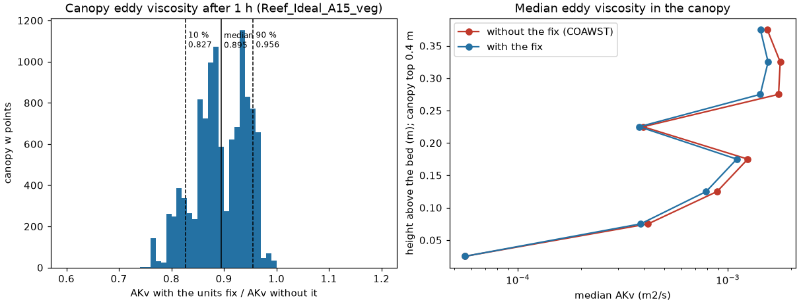

# roms-vegetation.patch: four fixes to ROMS's vegetation model

| | |
|---|---|
| **Type** | fix |
| **Changes results?** | yes: runs with vegetation could not run at all with periodic boundaries (crash), and the canopy turbulence changes (eddy viscosity about 10 % lower in the canopy); the v-direction barotropic drag changes very slightly |
| **Default** | on (all changes are inside `VEGETATION` code) |
| **Files** | `ROMS/Nonlinear/Vegetation/vegetation_drag.F` (`drag_work_array`), `ROMS/Nonlinear/Vegetation/vegetation_turb.F` (`zero_gap_stop`, `tau_veg_units`), `ROMS/Nonlinear/step2d_LF_AM3.h` (`v_drag_depth`) |
| **Evidence** | Reef_Ideal_A15_veg: stock crashes on the first step with heap corruption, patched runs; plants covering the bed stop with a message; canopy eddy viscosity -10.5 % (median) from the units fix; source check of all four (results below) |
| **Test** | [`tests/fixes/roms-vegetation/run.sh`](../../../../tests/fixes/roms-vegetation/run.sh), see its [README](../../../../tests/fixes/roms-vegetation/README.md) |
| **Upstream** | same code in COAWST v3.7, v3.8.1, v3.9 and in ROMS's own `vegetation_turb.F`; not reported yet |

## In short

COAWST's ROMS represents vegetation (seagrass, marsh, or in our reef cases
coral-like rigid elements) as a field of cylinders or blades with a density,
diameter, thickness and height at every grid point. The plants slow the flow
(drag) and change the turbulence (extra production and dissipation of
turbulent kinetic energy). Four problems in that code are fixed here:

| Change | What was wrong | Consequence |
|---|---|---|
| `drag_work_array` | a work array was declared smaller than the routines that fill it assume | with periodic boundaries (and on some MPI tiles), ROMS wrote past the end of the array: heap corruption, crash on the first time step |
| `zero_gap_stop` | when the plants cover the whole bed, the turbulence model divides by zero | the run blew up after 1 h 44 min with no hint why; now it stops at once with a message |
| `tau_veg_units` | a dissipation time scale used the plant work in the wrong units (integrated over the layer instead of per unit mass) | the time scale was 1.6-3 times too long in our canopy, so canopy turbulence was damped too little: eddy viscosity about 10 % too high |
| `v_drag_depth` | the barotropic drag on the v-velocity used the depth averaged in x instead of y | small error in the depth-averaged drag on v (under 0.04 mm/s in our case) |

## Background: how ROMS treats plants

With `VEGETATION`, ROMS reads plant fields from the initial file
(`plant_density`, `plant_diameter`, `plant_thickness`, `plant_height`, per
vegetation type). With `VEG_DRAG` it adds a quadratic drag in every layer
the plants occupy,

    F = 1/2 Cd D n |u| u        (per unit volume, D diameter, n density)

with `CD_VEG` from `vegetation.in`. With `VEG_TURB` it adds the plants'
effect on the GLS turbulence closure (Uittenbogaard 2003; Beudin et al.
2017, Kalra et al. 2017): the drag does work on the flow, `P_veg`, which is
added as a source of turbulent kinetic energy `k`, and a matching source of
dissipation `epsilon`,

    d(epsilon)/dt += c2 P_veg / tau_eff,     tau_eff = min(tau_free, tau_veg)

`tau_veg` is the time scale on which eddies the size of the gaps between the
plants decay,

    tau_veg = ( L^2 / (c_k^2 P_veg) )^(1/3),   L = c_l sqrt( (1 - D t n) / n )

where `L` is the gap between plants and `D t n` (diameter x thickness x
density) is the fraction of the bed the plants cover. (ROMS takes each
plant's footprint as diameter x thickness, a flat blade; for cylinders the
thickness must be pi/4 x diameter so that D x t is the cylinder's
cross-section; this repository's cases follow that convention.)

ROMS runs on several MPI processes, each owning a "tile" of the grid plus a
border of ghost (halo) points copied from its neighbours. Fields are
refreshed in the halo by exchange routines (`exchange_r2d_tile` for
periodic boundaries within a tile, `mp_exchange2d` between processes),
which assume the array has the halo bounds `LBi:UBi, LBj:UBj`.

## drag_work_array: a work array too small for the halo exchange

In `vegetation_drag.F` (same in v3.7, v3.8.1 and v3.9) the work array `wrk`
was declared with the tile-private bounds:

```fortran
      real(r8), dimension(IminS:ImaxS,JminS:JmaxS) :: wrk
```

`IminS:ImaxS` is the tile plus 3 points on each side, a convention for local
scratch arrays. But `wrk` is passed to `exchange_r2d_tile` and
`mp_exchange2d`, which index it with the halo bounds `LBi:UBi, LBj:UBj`.
Where the two ranges differ, the exchange reads and writes at shifted
positions, and past the end of the array, into whatever memory follows.

When does that happen? `LBi` depends on the number of ghost points: 2
normally, 3 with MPDATA tracer advection or biharmonic viscosity, and on
whether the tile touches a periodic boundary. In Reef_Ideal_A15_veg (east-west
periodic, MPDATA) `LBi` is -3 but `IminS` is -2. The exchange then overwrote
memory belonging to the C library's heap bookkeeping, and the first `malloc`
afterwards noticed: ROMS aborted on the first time step with
`malloc(): ... assertion failed` or `munmap_chunk(): invalid pointer`.
Where the bounds differ less, the wrong halo values pass silently. This is
most likely the "vegetation periodic boundary bug" known from older COAWST
versions.

**The fix** declares `wrk` with exactly the bounds the exchange routines use:

```fortran
!  wrk is exchanged with exchange_r2d_tile/mp_exchange2d, which index it
!  with the halo bounds LBi:UBi,LBj:UBj, so it must have exactly those
!  bounds (with IminS:ImaxS the exchange wrote past the array end).
      real(r8), dimension(LBi:UBi,LBj:UBj) :: wrk
```

Every use of `wrk` in the routine lies within these bounds, so nothing else
changes.

## zero_gap_stop: plants covering the whole bed

If `D t n >= 1`, the plants cover the whole bed: the gap `L` is zero (or the
square root of a negative number), `tau_veg` and `tau_eff` are zero, and
the dissipation source `c2 P_veg / tau_eff` is a division by zero. The
infinities first show up somewhere in the canopy, spread, and the run blows
up later, far from the cause. In our first vegetation test (D = t = 0.5 m,
n = 4 m-2: D t n exactly 1, because thickness had been set equal to
diameter) ROMS blew up after 1 h 44 min at the periodic seam, which looked
like a boundary problem.

COAWST v3.2-v3.7 had small `eps` guards that turned the infinity into a
finite but enormous source (1e12 times too large), wiping out the turbulence
in that cell instead of failing; they were removed in 2023.

**The fix** checks the plant fields at every step before the turbulence
calculation and stops on the first point with `D t n >= 1`, printing the
point and the values and saying what to do:

```
 VEGETATION_TURB - plants cover the whole bed: vegetation type 1, rho point (1,18):
                   diameter x thickness x density =  1.000E+00 >= 1
                   (diameter  5.000E-01 m, thickness  5.000E-01 m, density  4.000E+00 m-2).
                   The VEG_TURB length scale between the plants is zero.
                   For cylinders use thickness = pi/4 x diameter, and keep pi/4 x diameter^2 x density below 1.
```

Each process prints the message for its own tile, then the run stops
(`ERROR STOP`).

## tau_veg_units: the canopy time scale in the wrong units

`tau_veg = (L^2 / (c_k^2 P_veg))^(1/3)` needs `P_veg` as work per unit
mass, in m2/s3 (W/kg). The code's `tke_loc_veg` is built from the drag
`ru_loc_veg`, which already includes the layer thickness `Hz`, so it is the
work integrated over the w-cell, in m3/s3. That is what ROMS's GLS update
needs (it updates `Hz`-weighted `k` and `epsilon`), and there the variable
is used correctly; but in `tau_veg` it makes the time scale
`Hz^(-1/3)` times the published value. For our canopy layers, 4-26 cm thick,
that is 1.6 to 3 times too long. A too-long `tau_veg` means a too-weak
vegetation dissipation source, so the canopy keeps too much turbulence: too
much `k`, too little `epsilon`, too large an eddy viscosity. This has been
in the code since the original implementation (v3.4 checked).

**The fix** divides the work by the w-cell thickness that the GLS update
uses, only where `tau_veg` is computed:

```fortran
-              cff2=MIN( (1.0_r8/(ck**2.0_r8*tke_loc_veg)), max_eps )
+              Pveg=tke_loc_veg/(0.5_r8*(Hz(i,j,k)+Hz(i,j,k+1)))
+              cff2=MIN( (1.0_r8/(ck**2.0_r8*Pveg)), max_eps )
               tauveg=(L**2.0_r8*cff2)**one_third
```

(`Hz` is passed into the routine for this.) The `k` and `epsilon` sources
themselves are unchanged.

## v_drag_depth: the wrong depth average for the v-direction drag

In the barotropic (depth-averaged) step, the vegetation drag on `vbar` is
divided by the water depth at the v point, the average of the two cells on
either side in y. The code used the average in x, the u-point formula:

```fortran
-         cff3=2.0_r8/(Drhs(i-1,j)+Drhs(i,j))
+         cff3=2.0_r8/(Drhs(i,j-1)+Drhs(i,j))
```

It matters only where the depth changes between neighbouring cells; in the
A15 vegetation test the currents changed by under 0.04 mm/s.

## Kept as shipped: tau_free is never used

Also looked into, not changed (author's decision, 2026-10-21): the model is
`tau_eff = min(tau_free, tau_veg)` with `tau_free = k / epsilon`, but since
a 2023 edit (COAWST commit 866892c) the code computes
`inverse_dissip = MAX(1/dissip, max_eps)`, so `tau_free >= k x 1e14 s` and
`tau_eff = tau_veg` always; the same edit also reuses `cff2` (the epsilon
exponent) for `tau_veg`, which switches `tau_free` off a second time. The
papers that describe the model predate the edit. Restoring `tau_free`
(`MIN(1/dissip, max_eps)` plus a separate variable) lowered canopy TKE by 42 %
and eddy viscosity by 65 % (medians) in a 3 h A15 vegetation run and changed
currents by up to 2 cm/s. Kept off, on the argument that canopy turbulence
decays at canopy length scales; to revisit.

## How the test works

The test ([README](../../../../tests/fixes/roms-vegetation/README.md)) uses
the idealized reef with a constant canopy, `tests/cases/Reef_Ideal_A15_veg`:
plants 0.4 m tall, 0.5 m diameter, thickness pi/4 x 0.5 = 0.39 m, 4 per m2,
everywhere; ROMS and SWAN east-west periodic; waves and a tide. That case
needs periodic curvilinear SWAN and SWAN's extra NetCDF output, which are
improvements later in the series, so all builds borrow them:
series S = the fixes + `swan-netcdf-output` + `swan-periodic-curvilinear`.

| Run | Build | What it shows |
|---|---|---|
| `before` | S without this patch | `drag_work_array`: the case crashes at the start |
| `after` | S | the case runs to the end |
| `zerogap` | S, plants 0.5 m thick (D t n = 1) | `zero_gap_stop`: stops at once with the message |
| `nounits` | S with the one `Pveg` line reverted | `tau_veg_units`: compared with `after` |

Plus a source check (`check_source.py`) of all four changes on the series
before and after the patch.

## Engine test results

Run 2026-10-31: source check on the control VM; the four runs on Cloud
Batch, one c2d-standard-8 Spot VM each, ROMS 1x6 + 2 SWAN (cost a few
cents). PASS.

**Source check.** Before: all four BAD (`wrk` declared `IminS:ImaxS`; no
zero-gap check; `tau_veg` from `tke_loc_veg`; v drag with `Drhs(i-1,j)`).
After: all four ok.

**Runs:**

| Run | Result |
|---|---|
| `before` (30 min) | crashed after 3 s, on the first step: `Fatal glibc error: malloc.c:4376 (_int_malloc): assertion failed`, then `SIGABRT` on the ROMS processes |
| `after` (60 min) | ran to the end (272 s) |
| `zerogap` (10 min) | stopped after 2 s with `VEGETATION_TURB - plants cover the whole bed ... diameter x thickness x density = 1.000E+00 >= 1` |
| `nounits` (60 min) | ran to the end (244 s); compared below |

**Effect of `tau_veg_units`** on the canopy's eddy viscosity after 1 h
(w points inside the 0.4 m canopy, 11266 points): AKv with the fix divided
by AKv without it, 10th / 50th / 90th percentile **0.827 / 0.895 / 0.956**,
i.e. the eddy viscosity in the canopy is about 10 % lower (4-17 %). Earlier,
after 3 h, the same comparison gave -7 % (median) and -14 % (10th
percentile), with TKE -3 % and epsilon +2 %; currents changed by at most
4 mm/s and Hs by under 0.5 mm (canopy currents are weak in this case, about
2 cm/s).



*Left: ratio of canopy eddy viscosity with the fix to without it, at every
w point inside the canopy after 1 h. Right: median eddy viscosity against
height above the bed, with and without the fix (the line zigzags because a
given height lies at different model levels in water of different depth).
Made by `tests/fixes/roms-vegetation/plot_units_effect.py`.*

## Who is affected

- Any vegetation run with periodic boundaries, or with more than one ROMS
  tile and 3 ghost points (MPDATA, `UV_VIS4`): crash or silently wrong halo
  values (`drag_work_array`).
- Any `VEG_TURB` run: canopy turbulence (`tau_veg_units`); dense canopies
  with `D t n` near 1 (`zero_gap_stop`).
- Any vegetation run with the LF-AM3 barotropic step and varying depth
  (`v_drag_depth`, tiny).

## References

- Uittenbogaard, R. (2003): Modelling turbulence in vegetated aquatic flows.
- Beudin, A., Kalra, T. S., Ganju, N. K., Warner, J. C. (2017): Development of
  a coupled wave-flow-vegetation interaction model. Computers & Geosciences 100.
- Kalra, T. S., Aretxabaleta, A., Seshadri, P., Ganju, N. K., Beudin, A. (2017):
  Sensitivity analysis of a coupled hydrodynamic-vegetation model using the
  effectively subsampled quadratures method. Geoscientific Model Development 10.
