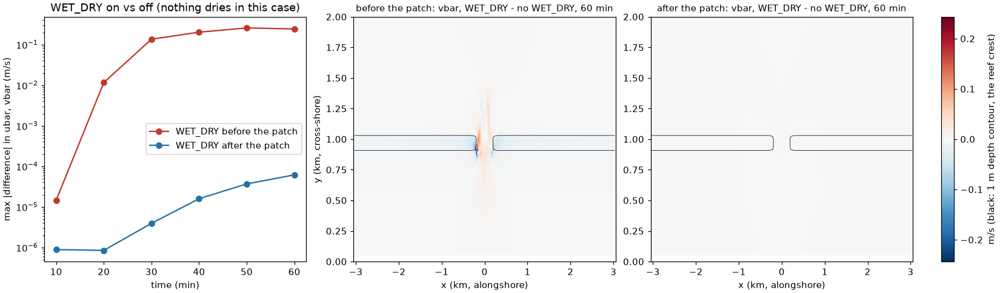

# roms-wetdry-stokes.patch: with wetting and drying, part of the Stokes transport was dropped

| | |
|---|---|
| **Type** | fix |
| **Changes results?** | yes, for 3-D runs with `WET_DRY`, waves (`WEC`) and the LF-AM3 barotropic step (COAWST v3.9's only one): in the idealized reef case the depth-mean current changed by up to 0.24 m/s within an hour; builds without `WET_DRY` are bit-identical |
| **Default** | on (all lines inside `WET_DRY`, or `WEC` + `WET_DRY` + `SOLVE3D`, code) |
| **Files** | `ROMS/Nonlinear/step2d_LF_AM3.h` (`first_substep_masks`) |
| **Evidence** | Reef_Ideal_A15, where nothing dries: with `WET_DRY` stock differs from the run without it by 0.24 m/s after 1 h, patched by 6e-5 m/s; builds without `WET_DRY` give a bit-identical executable |
| **Test** | [`tests/fixes/roms-wetdry-stokes/run.sh`](../../../../tests/fixes/roms-wetdry-stokes/run.sh), see its [README](../../../../tests/fixes/roms-wetdry-stokes/README.md) |
| **Upstream** | same code in COAWST `main` (2026-10-24); no issue in the COAWST tracker; not reported yet |

## In short

With wetting and drying (`WET_DRY`) switched on, COAWST masks the wave-driven
(Stokes) transport so that no water is pushed into dry cells. The formula it
uses is written for one kind of mask, but in the first sub-step of every
baroclinic step the masks in memory are of another kind. With those masks the
formula keeps the Stokes transport only where it points towards +x or +y, and
sets it to zero where it points towards -x or -y, even in cells that are wet
on all sides. So in every run with waves, wetting and drying and ROMS's
standard time stepping, part of the wave-driven transport was missing from
the barotropic (depth-averaged) solution, everywhere, whether anything dried
or not. In the idealized reef case, where nothing ever dries, switching
`WET_DRY` on changed the depth-mean current by up to 0.24 m/s within an hour
(the largest current is 1 m/s). With the fix the difference is 6e-5 m/s.

## Background: wetting and drying masks, and the barotropic sub-steps

**Wetting and drying.** With `WET_DRY`, a cell whose water depth falls below
`DCRIT` (here 0.10 m) is "dry": no flow may leave it, but flow may enter it
from a wet neighbour. ROMS implements this with masks on the velocity points
(`umask_wet`, `vmask_wet`). There are two kinds:

| Mask kind | Made by | Values |
|---|---|---|
| fast-step masks | `wetdry_mask_tile`, at every barotropic step | 2 = wet on both sides; +1 or -1 = one side dry, flow allowed only in the direction of the sign; 0 = dry on both sides |
| time-averaged masks | `wetdry_avg_mask_tile`, after the barotropic steps, for the 3-D step | 0 or 1, with the flow direction already taken into account |

**The barotropic sub-steps.** ROMS advances the depth-averaged flow and sea
level with many short "fast" steps inside each long baroclinic step. In the
LF-AM3 scheme each fast step has a predictor and a corrector sub-step. At
the start of the very first predictor sub-step, the masks in memory are still
the time-averaged ones left by the previous 3-D step (or set by
`wetdry_ini_tile` at the start of a 3-D run); `wetdry_tile`, which makes the
fast-step masks, is only called later in the same routine.

**The Stokes transport in the fluxes.** With waves, the barotropic fluxes
include the Stokes transport `ubar_stokes`, `vbar_stokes`. For wetting and
drying, `step2d_LF_AM3.h` masks it with a factor `cff7` computed from the
fast-step mask:

```fortran
          cff5=ABS(ABS(umask_wet(i,j))-1.0_r8)
          cff6=0.5_r8+DSIGN(0.5_r8,ubar_stokes(i,j))*umask_wet(i,j)
          cff7=0.5_r8*umask_wet(i,j)*cff5+cff6*(1.0_r8-cff5)
          cff1=cff1*cff7
          DUSon(i,j)=ubar_stokes(i,j)*cff1
```

For the fast-step values this is right: with `umask_wet` = 2 (wet both sides)
`cff5` = 1 and `cff7` = 1, the full transport; with +1 or -1, `cff5` = 0 and
`cff7` = 1 if the transport goes the allowed way, 0 if not; with 0, `cff7` = 0.

## The bug

The fluxes are computed before `wetdry_tile` is called, so in the first
predictor sub-step `umask_wet` holds the time-averaged mask, where a cell wet
on both sides has the value 1, not 2. With `umask_wet` = 1 the formula gives
`cff5` = 0 and `cff6` = 1 for `ubar_stokes` >= 0 but 0 for `ubar_stokes` < 0,
so

| Stokes transport | `cff7` | Transport kept |
|---|---|---|
| towards +x (or +y) | 1 | all of it |
| towards -x (or -y) | 0 | none |

in every wet cell. The dropped transport enters the sea level and the
time-averaged fluxes `DU_avg2` (where the first sub-step has the largest
weight), from which the 3-D flow takes its depth average. In a reef case with
waves coming from the north, the Stokes drift points towards -y almost
everywhere, so most of it was removed from that sub-step. The same code is in
COAWST `main` of 2026-10-24.

## The fix

In the first predictor sub-step, the averaged mask is already what the flux
should be multiplied by (0 or 1, direction included), so it is used directly;
in all other sub-steps the formula stays:

```fortran
#   ifdef SOLVE3D
          IF (FIRST_2D_STEP.and.PREDICTOR_2D_STEP(ng)) THEN
            cff7=umask_wet(i,j)
          ELSE
#   endif
          cff5=ABS(ABS(umask_wet(i,j))-1.0_r8)
          cff6=0.5_r8+DSIGN(0.5_r8,ubar_stokes(i,j))*umask_wet(i,j)
          cff7=0.5_r8*umask_wet(i,j)*cff5+cff6*(1.0_r8-cff5)
#   ifdef SOLVE3D
          END IF
#   endif
          cff1=cff1*cff7
```

The same change is made for v, in both copies of the flux loops (with and
without the distributed-memory special case). It applies only to 3-D runs
(`SOLVE3D`): a 2-D-only run starts from fast-step masks (`wetdry_ini_tile`
calls `wetdry_mask_tile` without `SOLVE3D`), for which the formula is right.
All added lines are inside `#ifdef WET_DRY` (or blocks that need `WEC`,
`WET_DRY` and `SOLVE3D`), so other builds compile to exactly the same Fortran.
The AB3-AM4 barotropic kernel (`3-experimental/roms-step2d-fb.patch`) computes
the fast-step masks before its fluxes and is not affected.

## How the bug was found

In a reef case where nothing dried, `WET_DRY` on and off gave depth-mean
currents up to 0.5 m/s apart on the reef crest. Since no cell was ever dry,
the masks should have changed nothing. Tracing the masks through one
baroclinic step showed values of 1 where the formula expects 2, in the first
predictor sub-step only.

## How the test works

`tests/fixes/roms-wetdry-stokes/run.sh` ([README](../../../../tests/fixes/roms-wetdry-stokes/README.md))
uses the idealized reef `tests/cases/Reef_Ideal_A15`: waves from the north,
spectral Stokes drift, a 0.15 m tide, and a crest 0.50 m deep, so the
shallowest water (0.35 m at low tide) never comes near `DCRIT` (0.10 m).
Nothing dries, so with a correct `WET_DRY` the flow should be almost the same
with it as without it. All builds include the fixes and the two improvements
A15's SWAN setup needs:

| Build | Options | Patch |
|---|---|---|
| `wd-before` | `+WET_DRY` | without this patch |
| `wd-after` | `+WET_DRY` | with it |
| `nowd-before`, `nowd-after` | `+LIMIT_BSTRESS` (the bottom-stress cap that `WET_DRY` brings, without wetting and drying) | without / with |

1. `nowd-before` and `nowd-after` must give the same executable (md5 of
   `coawstM`): the patch touches only `WET_DRY` code.
2. `wd-before`, `wd-after` and `nowd-after` run 60 min with history every
   10 min. The largest difference in `ubar`, `vbar`, `zeta` between each
   `WET_DRY` run and the run without it must be large before the patch
   (> 1 cm/s) and small after it (< 1 mm/s).

## Engine test results

Run 2026-10-31; images built on the control VM, runs on Cloud Batch
(c2d-standard-8 Spot VMs, ROMS 1x6 + 2 SWAN, about 250 s each). PASS.

**Builds without `WET_DRY`:** `coawstM` md5 `788eeea3366f43799b58f06a543246d5`
before and after the patch: identical.

**Runs, largest |difference| from the run without `WET_DRY`:**

| Time | before: ubar | before: vbar | before: zeta | after: ubar | after: vbar | after: zeta |
|---|---|---|---|---|---|---|
| 10 min | 1.2e-5 | 1.5e-5 | 6.7e-7 | 4.3e-7 | 8.9e-7 | 4.5e-8 |
| 20 min | 1.2e-2 | 8.3e-3 | 1.8e-4 | 8.5e-7 | 4.0e-7 | 7.5e-8 |
| 30 min | 7.4e-2 | 0.14 | 2.5e-3 | 3.9e-6 | 1.2e-6 | 1.6e-7 |
| 40 min | 0.18 | 0.20 | 5.7e-3 | 1.6e-5 | 2.9e-6 | 4.4e-7 |
| 50 min | 0.22 | 0.26 | 9.1e-3 | 3.7e-5 | 1.0e-5 | 3.2e-6 |
| 60 min | 0.22 | 0.24 | 1.2e-2 | 6.2e-5 | 1.1e-5 | 9.0e-7 |

(m/s for currents, m for sea level; the largest |vbar| in the run is
1.04 m/s.) Before the patch, the difference grows by four orders of magnitude
in 30 min and reaches a quarter of the largest current; the sea level differs
by 12 mm. After it, the run with `WET_DRY` stays within 6e-5 m/s of the run
without it. The remaining difference comes from the other effects of
`WET_DRY`, which are tiny where nothing dries (e.g. the doubled no-slip
stress at land walls).



*Left: the largest difference in the depth-mean current between the runs
with and without `WET_DRY`, against time (log scale), before (red) and after
(blue) the patch. Middle and right: that difference in vbar after 60 min,
before and after, same colour scale; the black line is the 1 m depth contour
(the reef crest), with the pass in the middle. Before the patch the error is
largest in and around the pass, where the wave-driven flow over the crest
returns offshore. Made by `tests/fixes/roms-wetdry-stokes/plot_wetdry.py`.*

Earlier results with the same change (2026-10-24, control VM, 6 ROMS + 2
SWAN): 0.24 m/s in vbar and 12 mm in sea level unpatched, 6e-5 m/s and 3e-6 m
patched.

## Who is affected

Every 3-D run with `WET_DRY`, waves (`WEC`) and LF-AM3, whether or not anything
dries: the Stokes transport towards -x and -y is missing from the first
barotropic sub-step of every baroclinic step. Runs without `WET_DRY`, without
waves, or 2-D only are not affected.
