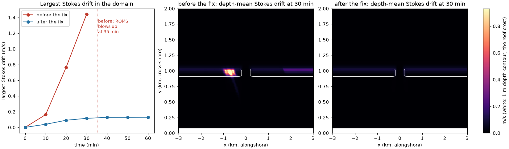

# swan-periodic-fixes.patch: SWAN with periodic lateral boundaries (REPEATING)

| | |
|---|---|
| **Type** | fix |
| **Changes results?** | yes, for SWAN with `COORDINATES ... REPEATING`: output on the computational grid (`periodic_compgrid_frame`), runs with several SWAN processes (`periodic_y_strips`, crashed before), coupled periodic runs with spectral Stokes drift (`periodic_coupled_stokes`); non-periodic runs are unchanged bit for bit |
| **Default** | on |
| **Files** | `swanpre1.ftn` (`periodic_compgrid_frame`); `swanparll.ftn`, `swancom1.ftn`, `swanmain.ftn`, `swanpre3.ftn`, `waves_coupler.ftn` (`periodic_y_strips`); `waves_coupler.ftn` (`periodic_coupled_stokes`) |
| **Evidence** | standalone periodic SWAN: COMPGRID output on the grid points, 4 processes = 1 process (garbage before); coupled periodic A15: Stokes drift 1.44 m/s and blow-up at 35 min before, 0.13 m/s and a clean hour after; source check of `periodic_y_strips` and `periodic_coupled_stokes` (results below) |
| **Test** | [`tests/fixes/swan-periodic-fixes/run.sh`](../../../../tests/fixes/swan-periodic-fixes/run.sh) and [`run_a15_coupled.sh`](../../../../tests/fixes/swan-periodic-fixes/run_a15_coupled.sh) |
| **Upstream** | not reported (SWAN's manual calls `REPEATING` "only for academic cases") |

## Background

`COORDINATES CARTESIAN REPEATING` makes SWAN's grid periodic in x: waves
leaving through the east side come back in through the west side. It is the
natural choice for an idealized coast that is uniform alongshore, or periodic
like a row of reef passes: no artificial side boundaries, where SWAN otherwise
has no incoming waves and casts a wave shadow into the domain (up to 1.2 m of
Hs in the test below). ROMS has the same option (`EWperiodic`), so in a
coupled run both models can be periodic. In COAWST v3.9 the option worked
only in the simplest case (serial SWAN, output on explicitly defined frames,
no coupling).

## `periodic_compgrid_frame`: output on the computational grid missed half its points

With `REPEATING` a regular grid has MXC points at x = 0 ... XCLEN - DX (the
point at x = XCLEN is x = 0 again), but SWAN's built-in `COMPGRID` output frame
spread its MXC points over 0 ... XCLEN (spacing XCLEN/(MXC-1)). So
`BLOCK 'COMPGRID'` output was interpolated between grid points, and about half
of it came out as exception values (NaN in NetCDF). The coupler evaluates the
fields it sends to ROMS on the same frame, so a periodic coupled run would also
have sent ROMS misplaced and missing wave fields. Fix: frame length
XCLEN - DX when `REPEATING`.

## `periodic_y_strips`: several SWAN processes crashed on periodic grids longer in x than in y

SWAN cuts its grid into strips across the longer side, x-strips if
MXC > MYC. Its halo exchange and sweep pipeline never wrap around in x, so
with `REPEATING` the strips at the seam got no neighbour data: a segfault in
`SWRECVAC` on the first step, or (once) a run that finished with Hs below
0.02 m everywhere. y-strips are fine, since each process then holds the whole
period. Fix: with `REPEATING`, always cut into y-strips. The direction is
decided at 22 places (partitioner, block administration, sweep pipeline,
output collection, nesting, COAWST's coupler); each test `MXC > MYC` gets
`.AND. KREPTX .EQ. 0`.

## `periodic_coupled_stokes`: in coupled periodic runs the spectral Stokes fields reached ROMS shifted

With `REPEATING` the coupling layout has one column more per row than SWAN's
grid (ROMS's i = 0 ... Lm+1 against SWAN's MXC columns), and the ordinary wave
fields (Hs, period, dissipation, ...) are re-indexed for that. The spectral
fields that ROMS's `SPECTRUM_STOKES` uses (`KSS`, `USS`, `VSS`, one per
frequency) were still taken as in the non-periodic layout, so row j came out
shifted by j - 1 columns. In the first coupled periodic run of the idealized
reef case A15 (2026-10-21), the deep pass's spectra landed on the 0.5 m deep
crest, the Stokes drift there reached 1.4 m/s (0.1 m/s in the non-periodic
run), and ROMS blew up after 35 minutes. Fix: build an index map (`isrc`)
alongside the ordinary fields and take the spectra through it. Non-periodic
runs use the same indices as before.

## Test

`tests/fixes/swan-periodic-fixes/run.sh SOURCE OUTDIR`:

1. **Source check** (`check_source.py`): every x-strip test excludes periodic
   grids (`periodic_y_strips`); the spectral Stokes fields go through `isrc` (`periodic_coupled_stokes`).
2. **Standalone SWAN** (`tests/cases/Swan_Periodic_Test`, inputs from
   `make_inputs.py`): an A15-like reef with one pass (A15's cross-shore
   profile, `a15_profile.txt`), periodic in x, waves Hs 1 m, Tp 10 s from
   20 deg east of north, 1 h. Grid `wide` (4 km, 200 x 121 points: x-strips
   before the patch) and `tall` (2 km, 100 x 121: y-strips, the control), each
   with 1 and 4 SWAN processes. Checks: 4 processes give the 1-process Hs
   (`periodic_y_strips`); `COMPGRID` output equals output on a frame on the grid points,
   none missing (`periodic_compgrid_frame`).

3. **Coupled run on the idealized reef** (`run_a15_coupled.sh`,
   `periodic_coupled_stokes`): `tests/cases/Reef_Ideal_A15`, ROMS and SWAN both
   periodic, spectral Stokes drift, 1 h. A15's SWAN grid is curvilinear, and
   periodic curvilinear grids are an improvement later in the series
   (`2-improvements/swan-periodic-curvilinear`), as is the NetCDF output the
   case asks for (`2-improvements/swan-netcdf-output`); both builds borrow
   them. The "before" build has every SWAN change except
   `periodic_coupled_stokes` (`tests/tools/variant_patches.sh` regenerates the
   SWAN patches without it), the "after" build has all of them, so the only
   difference between the two is this change.

## Engine test results

Run 2026-10-30/31 on the control VM; "before" is the series up to this patch
(so it already has the output fixes), "after" adds it. PASS:

```
== 1. source check
before: periodic_y_strips  x-strip tests (MXC > MYC): 22, without KREPTX.EQ.0: 22   BAD
        periodic_coupled_stokes  spectral Stokes fields taken through: ['points']         BAD
after:  periodic_y_strips  ... without KREPTX.EQ.0: 0                               ok
        periodic_coupled_stokes  ... taken through: ['isrc']                              ok
== 2. standalone periodic SWAN, Hs after 1 h
before: periodic_y_strips  wide (x-strips): 4 vs 1 processes  max |diff| 1.35 m,
                 Hs max 0.0198 m (the 4-process run is garbage)           BAD
        periodic_y_strips  tall (y-strips, control): 4 vs 1   bit-identical         ok
        periodic_compgrid_frame  wide: COMPGRID vs grid points      0 missing, values differ BAD
        periodic_compgrid_frame  tall: COMPGRID vs grid points      0 missing, values differ BAD
after:  periodic_y_strips  wide: 4 vs 1 processes             bit-identical         ok
        periodic_y_strips  tall: 4 vs 1 processes             bit-identical         ok
        periodic_compgrid_frame  wide, tall: COMPGRID vs grid points  identical, 0 missing  ok
```

`periodic_y_strips` before: the 4-process run on the x-strip grid did not crash this time
but produced Hs below 0.02 m everywhere (the 1-process run reaches 1.4 m),
the second failure mode seen in the earlier tests. `periodic_compgrid_frame` before: COMPGRID
output was off by up to 0.24 m (wide) and 0.25 m (tall) against the output on
the grid points, being interpolated between them; no point was missing in
this run. In the earlier tests (before the output fixes) about half were
missing; that part was most likely the uninitialised output flags of
`swan-output-fixes` (`output_obstacle_flags`), which this series fixes first.

**3. Coupled run on A15** (2026-10-31; "before" on the control VM, ROMS 1x2 +
2 SWAN; "after" on a Cloud Batch c2d-standard-8 VM, ROMS 1x6 + 2 SWAN). PASS:

```
before: blow-up yes, records at 0, 10, 20, 30 min,
        max |Stokes drift| per record: 0.000, 0.163, 0.765, 1.442 m/s
after : blow-up no, records at 0, 10, 20, 30, 40, 50, 60 min,
        max |Stokes drift| per record: 0.000, 0.040, 0.091, 0.115, 0.128, 0.129, 0.130 m/s
```

Without the change, ROMS's largest speed grew at the reef crest next to the
pass (i = 69, rows 32-34: 3.4, 7.0, 11.6, then 45.7 m/s in the last steps) and
ROMS stopped at 35 min 12 s (`Blowing-up ... REASON: MaxSpeed = Infinity`),
as in the first coupled periodic A15 run of 2026-10-21 (Stokes drift
1.4 m/s, blow-up after 35 min). Row j of the spectra had landed j - 1 columns
to the side: the spectra of the deep pass, where the waves are large, were
put onto the shallow crest, whose depth turns them into a huge Stokes drift.
With the change the drift stays at about 0.13 m/s, the size it has in a
non-periodic run.



*Left: the largest Stokes drift in the domain against time. Middle and right:
depth-mean Stokes drift speed at 30 min, before and after the fix, same colour
scale; the white line is the 1 m depth contour, i.e. the reef crest, with the
pass at x = 0. Before the fix a hot spot of false Stokes drift sits on the
crest just west of the pass. Made by
`tests/fixes/swan-periodic-fixes/plot_a15_coupled.py`.*

## Earlier results (2026-10-21, same changes, more cases)

| Check | stock SWAN | patched |
|---|---|---|
| pass across the seam vs pass in the middle shifted by half a period, 1 process | 3e-5 m | same |
| 4 vs 1 process, periodic, y-strips | identical | identical |
| 4 vs 1 process, periodic, x-strips | segfault in `SWRECVAC` (once: Hs < 0.02 m everywhere) | identical |
| `BLOCK 'COMPGRID'` output, periodic | about half missing, rest interpolated | equals output on the grid points |
| non-periodic vs periodic | up to 1.2 m Hs difference near the upwave side | same |

Non-periodic runs and the serial periodic computation are unchanged by the
patch, bit for bit. The seam residual (at most 3e-5 m, in the lagoon) is at
the level of SWAN's iteration error: one sweep per time step does not converge
exactly where the sweep order meets the seam.

## Limits

Not periodic, as before: SWAN's own `SETUP` and `DIFFRACTION`, and obstacles
across the seam. Curvilinear periodic grids: the improvement
`swan-periodic-curvilinear`.
