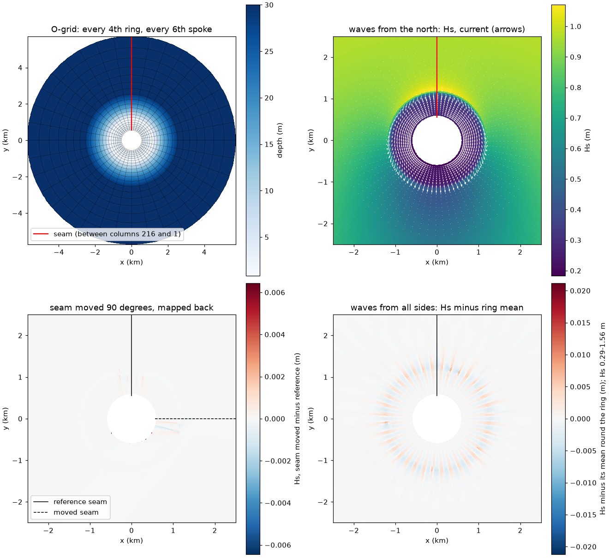

# swan-closed-ring.patch: SWAN and the coupler on grids that close round an island

| | |
|---|---|
| **Type** | improvement (new capability) |
| **Changes results?** | new: coupled ROMS + SWAN runs on O-grids (grids that close on themselves round an island), which SWAN refused before; periodic grids that do not close are unchanged (Reef_Ideal_A15 bit-identical) |
| **Default** | on; used when a `REPEATING` curvilinear grid's closing column is its first column (period vector zero) |
| **Files** | `SWAN/src/swanpre1.ftn`, `swanmain.ftn`, `swanser.ftn`, `swmod1.ftn`, `waves_coupler.ftn` (`closed_ring`) |
| **Evidence** | Circle_Island (round island with a fringing reef, 216 x 80 O-grid, 1 h coupled): refused before; after, the coupler moves Hs to ROMS exactly (also in ROMS's two seam columns) and zeta to SWAN as expected, with 1, 2 and 3 SWAN processes; layouts give identical results; moving the seam 90 degrees changes results by at most 0.28 of what SWAN's own iteration count does; waves from all sides give Hs repeating every 10 degrees within 0.6 %, no worse at the seam; restart to round-off |
| **Test** | [`tests/improvements/swan-closed-ring/run.sh`](../../../../tests/improvements/swan-closed-ring/run.sh), see its [README](../../../../tests/improvements/swan-closed-ring/README.md); case [`tests/cases/Circle_Island`](../../../../tests/cases/Circle_Island/README.md) |
| **Generated by** | [`generators/make_swan_patches.py`](../generators/make_swan_patches.py) |
| **Needs** | `swan-periodic-curvilinear` (applied before it in the series) |
| **Upstream** | not reported yet |

## In short

A grid round an island can be built in polar fashion: one grid direction
goes round the island and closes on itself, the other goes outwards. Such an
O-grid follows the coast everywhere, has no corners, and puts its only
open boundary far offshore. ROMS handles it as a periodic grid in the
direction round the island. SWAN, with `swan-periodic-curvilinear`, handles
periodic curvilinear grids, but only those whose period is a shift: there
the coordinate file's extra last column is the first column moved by one
period, and SWAN reads the period from it. On a closed grid the extra
column is the first column itself. The period vector is zero, and SWAN
stopped with "REPeating curvilinear grid: no period found".

Accepting a zero period in SWAN is the small part. The larger part is the
coupler. COAWST's coupler lays out each row of a periodic grid as SWAN's
columns plus one, because on a shifted periodic grid SWAN's extra column
lines up with ROMS's extra column. On a closed grid that extra column has
zero width, and the layout must instead be ROMS's own: SWAN's column k is
ROMS's column k (k = 1..Lm), and ROMS's two periodic copy columns, 0 and
Lm+1, are SWAN's last and first columns. The patch adds a flag, `KRING`,
set when the grid closes, and maps both directions of the exchange with it.
A third change makes SWAN's check for isolated wet points wrap round the
seam.

## Background: an O-grid in ROMS and in SWAN

```
        outer ring (open: tide, waves)            ROMS rho columns 0 .. Lm+1
     .-''''''''''''''''-.                      0 = copy of Lm, Lm+1 = copy of 1
   .'    .-'''''''-.     '.                     SWAN columns 1 .. MXC = Lm
  /    .'  island   '.     \                    (coordinate file: 1 .. Lm+1,
 |    |   (closed)    |     |                    Lm+1 = column 1 again)
  \    '.           .'     /
   '.    '-.......-'     .'     seam: between column Lm and column 1
     '-.______________.-'
```

- **ROMS**: xi round the island is periodic (`LBC` west and east `Per`). The
  grid file holds columns 0..Lm+1, with column 0 equal to column Lm and
  column Lm+1 equal to column 1. The island side is a closed southern
  boundary; the outer ring is the open northern boundary.
- **SWAN**: `COORDINATES ... REPEATING` and `CGRID CURVILINEAR Lm Mm+1`;
  `READGRID COORDINATES` reads one column more than the grid has (the
  closing column), here ROMS columns 1..Lm+1. SWAN works in Cartesian
  coordinates. It stores them in single precision, so a real grid should
  use a local origin.
- **The coupler** (MCT) exchanges whole rows: ROMS sends and receives
  columns 0..Lm+1 (Lm+2 values per row); SWAN must give and take the same
  number in the same order.

## closed_ring: the change

**Detecting a closed grid** (`swanpre1.ftn`, `CVPERI`; `swmod1.ftn`,
`swanmain.ftn`): after reading the coordinates, SWAN computes the period
vector from the closing column. A length below the coordinate tolerance now
means a closed grid:

```fortran
!        closed grid (O-grid around an island): column MXC+1 is column 1
!        itself and the period vector is zero
         IF (SQRT(XCPER**2+YCPER**2) .LE. TOL) THEN
            XCPER = 0.
            YCPER = 0.
            KRING = 1
            WRITE (PRINTF, '(A)') ' REPeating curvilinear grid is '//
     &         'closed (period vector 0)'
         ENDIF
```

and the error check in `swanmain.ftn` that stopped the run on a zero period
now does so only when `KRING = 0`. The output-point search (`swanser.ftn`),
which tries copies of a point one period either side, skips that guess on a
closed grid, where it would divide by the period length.

**The coupler's layout** (`waves_coupler.ftn`): the row length on a periodic
grid was MXC+1; with `KRING` it is MXC+2, so SWAN's rows line up with
ROMS's 0..Lm+1:

```fortran
!  before
        IF (KREPTX.eq.1) THEN
          Isize=MXCGL+1
!  after
        IF (KREPTX.eq.1) THEN
          Isize=MXCGL+1+KRING
```

(and likewise for the parallel layouts, and `MXCGLc`, the global row length
the coupler's index map is built from).

**SWAN to ROMS** (`waves_coupler.ftn`, sending): each row now starts with
SWAN's last column (ROMS i = 0) and ends with SWAN's first (ROMS i = Lm+1):

```fortran
!         closed grid: the first slot (ROMS i = 0) is SWAN column MXC
          IF (KRING.EQ.1) THEN
            IPI=IPI+1
            avdata(IPI)=REAL( VOQ(IP+MXC,VOQR(IVTYPE)),m8 )
            isrc(IPI)=IP+MXC
          END IF
          DO i=1,Isize-1-KRING
            ...
!         closed grid: the last slot (ROMS i = Lm+1) is SWAN column 1
          IF (KRING.EQ.1) THEN
            avdata(IPI)=REAL( VOQ(IP-MXC+1,VOQR(IVTYPE)),m8 )
```

**ROMS to SWAN** (`waves_coupler.ftn`, receiving, the 11 places that unpack
a field: depth, water level, currents, bottom roughness, plant fields): the
row's first slot (ROMS i = 0) is skipped,

```fortran
        DO IY=Jstr,Jend
          IF (KREPTX.EQ.1) IP=IP+KRING
          DO IX=Istr,Iend
            IP=IP+1
```

and the last slot (ROMS i = Lm+1) by the skip that was already there for
periodic grids.

**Isolated points across the seam** (`swanpre1.ftn`, `VALIDBP`): SWAN removes
wet points that have no wet neighbour or connect two areas only in one
dimension. The test looked at columns IX-1 and IX+1 without wrapping, so a
point in column 1 whose wet neighbours were above it and across the seam
could be removed (dry in SWAN, wet in ROMS). It now wraps for any
`REPEATING` grid: column 0 is column MXC and column MXC+1 is column 1.

## How it was found

The first version of the receiving side skipped the extra slot once per row
in one place but not in another. With 2 SWAN processes it silently
scrambled the depth ROMS sent to SWAN (rows shifted against each other);
with 3 or more it read past the end of the buffer and the run produced NaN.
SWAN's output at the start of a run comes before the first exchange, so
such errors show only at later output times. The test therefore compares
both directions of the exchange at every output time after the first, with
1, 2 and 3 SWAN processes.

## How the test works

`tests/improvements/swan-closed-ring/run.sh`
([README](../../../../tests/improvements/swan-closed-ring/README.md)) uses
`tests/cases/Circle_Island`
([README](../../../../tests/cases/Circle_Island/README.md)): a round island
of radius 600 m with a fringing reef (3 m lagoon, crest 0.8 m deep at
1150 m, fore reef to 47 m at 5.8 km), on a log-polar O-grid of 216 columns
round the island and 80 rings outwards (square cells, 17.5 to 169 m),
coupled every 600 s, physics as Reef_Ideal_A15. 216 columns are 6 per SWAN
direction bin (36 bins), so turning the grid by 6 columns turns it by
exactly one bin.

It builds the case before and after the patch, and Reef_Ideal_A15 before and
after, and runs (1 h each):

| Run | What it checks |
|---|---|
| `before` | stock behaviour on a closed grid |
| `north` (waves from the north, ROMS 6x1 + 2 SWAN) | the reference; the coupler's map |
| `north-1x6-1swan`, `north-2x2-3swan` | other ROMS tilings and 1 and 3 SWAN processes |
| `north-roll54` | the same domain numbered from 90 degrees further on (seam at east, where waves from the north cross it) |
| `north-it5`, `north-roll54-it5` | the two above with 5 SWAN iterations per time step instead of 1 |
| `inward` | the same waves aimed straight inward at every point of the outer ring, so the forcing is the same all round |
| `a15-before`, `a15-after` | a periodic grid that does not close |
| `restart` | 30 + 30 min restarted against 60 min straight (on the closed grid) |

## Engine test results

Run 2026-10-31 on Cloud Batch (c2d-standard-8 Spot, 2-4 min per run, 10 min
with 5 SWAN iterations); `before` on the control VM. PASS.



*Top left: the O-grid (every 4th ring and 6th spoke) and its depth; the
seam in red. Top right: Hs and depth-mean current after 1 h with waves from
the north: waves break on the crest, water flows over the north reef into
the lagoon, round it, and out over the sides. Bottom left: Hs with the seam
moved 90 degrees, mapped back, minus the reference: differences only near
the two seam positions on the reef, at most 6 mm. Bottom right: waves from
all sides, Hs minus its mean round each ring: the 10-degree pattern of
SWAN's direction bins (about 1 % of Hs), the same at the seam (black) as
elsewhere.*

**Before the patch** SWAN stops before computing:
`** Severe error : REPeating curvilinear grid: no period found`.

**The coupler**: at every output time after the first, in all seven runs
after the patch:

| Direction | Result |
|---|---|
| SWAN Hs to ROMS `Hwave` | **identical** at every wet point, including ROMS's copy columns 0 and Lm+1 |
| ROMS zeta to SWAN's water level | equal to the zeta of the previous exchange within 1.1e-4 m (1.5e-4 with waves from all sides) |

The zeta comparison is not exact, because SWAN holds the value ROMS sent at
the previous exchange, taken one time step from the output time. For scale:
zeta changed by 2.3e-2 m over those 10 min, and a map off by one ring would
give 2.3e-2 m. A map off by one column would give 7.4e-4 m; zeta varies
little round the island, so this is the weaker test of the two.

**Layouts**: ROMS 6x1 + 2 SWAN, 1x6 + 1 SWAN and 2x2 + 3 SWAN give identical
`zeta`, `Hwave`, `ubar`, `vbar` and `AKv` after 1 h (`u`, `v` within 1e-11 of
their size).

**The seam** (jump across the seam beyond the largest jump between other
neighbouring columns within 20 columns, relative to each field's size): at
most 6e-4 in `u` and `ubar`, 4e-4 in `AKv`, zero in `zeta` and `Hwave`.

**Moving the seam 90 degrees** (largest difference at 1 h, relative to each
field's size; the seam is at north in one run, at east in the other):

| | zeta | Hwave | ubar | vbar |
|---|---|---|---|---|
| seam moved, 1 SWAN iteration per step | 4.2e-3 | 6.4e-3 | 1.9e-2 | 1.2e-1 |
| seam moved, 5 iterations per step | 7.6e-4 | 4.7e-3 | 5.3e-3 | 2.0e-2 |
| same seam, 1 vs 5 iterations | 1.3e-1 | 8.1e-2 | 3.8e-1 | 4.3e-1 |

In absolute terms the 1-iteration differences are 0.3 mm in sea level, 6 mm
in Hs and 2 cm/s in radial current (0.23 m/s at most). They sit on the reef
crest next to the two seam positions, are largest when the wave front
arrives (20 min), and shrink 3-6 times with 5 iterations. They come from
SWAN's solver, not from the coupler. SWAN sweeps the grid column by column
starting at column 1, so on a periodic grid column 1 uses its neighbour
across the seam from the previous iteration. With one iteration per time
step (SWAN's default in nonstationary mode) that lag does not vanish while
the waves are changing. The same applies to any periodic SWAN grid, closed
or not: in `swan-periodic-curvilinear`'s test, moving the seam through a
reef pass changed Hs by 3e-5 m in standalone SWAN, where the waves come to
a steady state. The number of SWAN iterations itself changes results far
more: 1 against 5 iterations differ by 8 cm in Hs and 8 cm/s in currents,
3.5 times or more the effect of moving the seam.

**Waves from all sides**: SWAN's Hs at 1 h, turned by 6 columns (one
direction bin), differs by at most 8.6e-3 m (0.55 % of Hs); 7.4e-3 m near
the seam, 8.0e-3 m far from it. Not round-off, for two reasons: the
wave-driven flow over the reef does not stay the same all round (azimuthal
currents up to 1.5 cm/s grow from small differences), and SWAN's sweep lag
at the seam during the wave front's arrival is carried round the ring
within the same sweep. At 10 min, before the flow develops, ROMS fields near
the seam differ from their 10-degree neighbours 5-30 times more than far
from it (zeta 4e-6 against 7e-7 m). Two points of the outer boundary row,
beside the seam, have Hs 2.2 cm lower than the rest of that row (1.110
against 1.131 m): they are the two ends of the boundary segment
(`BOUNDSPEC SEGMENT IJ 0 Mm+1 Lm-1 Mm+1`), which SWAN treats as segment ends
even though the ring closes. The row inside is uniform to 2e-4 relative.

**Unchanged elsewhere**: Reef_Ideal_A15 (periodic, not closed) before and
after the patch: every variable of the ROMS history and SWAN's Hs
bit-identical after 1 h.

**Restart**: 30 + 30 min against 60 min straight agree to round-off (1e-11
of the field sizes; zeta, depth-mean currents, AKv, tke and SWAN's Hs
bit-identical), on the closed grid with waves breaking all round.

Two problems were found on the way to that result. Neither comes from this
patch:

- **`restart_record`** (a fix to `roms-restart-wec`): the case writes a
  restart record every 10 min, and the third record stopped ROMS.
- **The case's start date.** The first version of this case gave a 4.5e-5
  residual. The restarted run left the uninterrupted one in its first step,
  in the top layer over the crest. Traced (2026-10-31): the initial file's
  time is "seconds since 2000-01-01". With `TIME_REF = 0` ROMS counts time
  from year 0, so the model time is about 6.3e10 s. With `DSTART = 0`, the
  step number `(time - DSTART)/DT + 1` is about 1.6e10. That does not fit
  in ROMS's 4-byte step counter, which ends up at 1. A restarted run then
  starts counting at step 1, which ROMS's 3-D time stepping takes for a cold
  start: an Euler step, then AB2, instead of continuing the AB3 history that
  `PERFECT_RESTART` restored. The two agree where the forcing is steady and
  differ where it had just changed (the crest, after the wave update at the
  restart time). Setting `DSTART = 730119` days (2000-01-01 from year 0) in
  the case's `ocean.in` fixes it. Runs without a restart are bit-identical
  with or without it. Any case whose initial file carries a calendar date
  needs `DSTART` set to that date. Since `roms-restart-step-count`, a
  restart with such a `DSTART` stops with a message.

## Limits

- **The seam is not free**: SWAN's sweep starts there. With one iteration
  per time step, results near the seam differ by a few mm in Hs and a few
  cm/s in currents from a run with the seam elsewhere, while the waves are
  changing. More iterations (`NUMERIC ... NONSTAT mxitns`) reduce this. Put
  the seam where the waves cross it least (along the main wave direction)
  or where little happens.
- **The wave boundary segment has two ends** at the seam even on a closed
  ring; the boundary values at those two points are about 2 % low. The
  next row in is not affected.
- `READGRID COORDINATES` must repeat the first column exactly (to the
  coordinate tolerance); otherwise SWAN takes the difference as a period.

## Who is affected

Coupled ROMS + SWAN runs on grids that close round an island. Other
periodic and non-periodic grids are unchanged.
