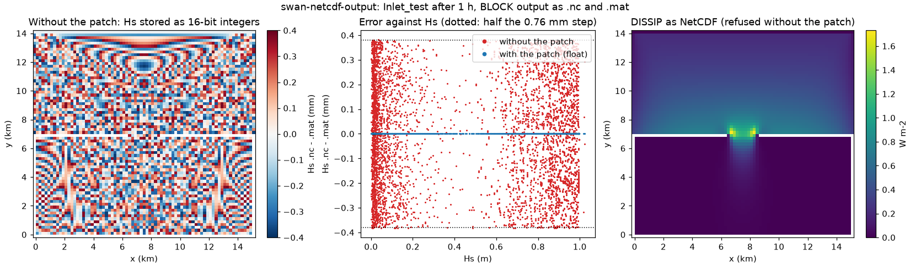

# swan-netcdf-output.patch: every SWAN output quantity as NetCDF, at full precision

| | |
|---|---|
| **Type** | improvement |
| **Changes results?** | output only: NetCDF files hold more quantities and exact values; the wave computation, the coupling and every other output are bit-identical |
| **Default** | on |
| **Files** | `SWAN/src/swn_outnc.ftn90` (`netcdf_names`), `SWAN/src/nctablemd.ftn90` (`netcdf_records`), `SWAN/src/agioncmd.ftn90` (`netcdf_float`) |
| **Evidence** | Inlet_test, 25 quantities written both as `.nc` and as `.mat`: `.nc` equal to `.mat` everywhere; stock SWAN refuses 18 of them as `.nc` and stores 5 of the other 7 with errors up to 0.38 mm (Hs) |
| **Test** | [`tests/improvements/swan-netcdf-output/run.sh`](../../../../tests/improvements/swan-netcdf-output/run.sh), see its [README](../../../../tests/improvements/swan-netcdf-output/README.md) |
| **Generated by** | [`generators/make_swan_patches.py`](../generators/make_swan_patches.py) |
| **Upstream** | not reported yet |

## In short

SWAN can write its results as NetCDF (`.nc`), the format ROMS uses and most
analysis tools read. In the SWAN version inside COAWST v3.9 that output had two
limits:

| Change | What was limited | What you would see |
|---|---|---|
| `netcdf_names`, `netcdf_records` | only about a third of SWAN's 2-D output quantities had a NetCDF name and description; for the others SWAN refused the request | `** Error : netCDF output not allowed for dissip.nc`, and (with `swan-stop-on-input-errors`) the run stops before it starts |
| `netcdf_float` (and `netcdf_records`) | most quantities were stored as 16-bit or 8-bit integers, scaled to a fixed range | Hs in steps of 0.76 mm, currents in steps of 0.6 mm/s: errors up to half a step in every value, 4 % of a 1 cm wave |

The patch gives every 2-D output quantity a NetCDF name, a description and
units (96 new table entries), and stores every quantity as a 32-bit float,
the precision SWAN computes in. Nothing else changes: the waves, the
coupling with ROMS and every non-NetCDF output are bit-identical.



*Inlet_test after 1 h. Left: Hs in the stock `.nc` file minus Hs in the
`.mat` file of the same run: the packing error, between -0.38 and +0.38 mm
everywhere. Middle: the same against Hs, before (red) and with the patch
(blue, zero). Right: total dissipation (`DISSIP`), which stock SWAN refused to
write as NetCDF, from the `.nc` file written with the patch.*

## Background: how SWAN writes NetCDF

A SWAN output request names locations and quantities, and the file name
decides the format:

```
BLOCK 'COMPGRID' NOHEADER 'hsig.mat' LAY 4 HSIGN 1. OUTPUT 20000101.000000 1 HR
BLOCK 'COMPGRID' NOHEADER 'hsig.nc'  LAY 4 HSIGN 1. OUTPUT 20000101.000000 1 HR
```

For `.mat` (MATLAB) output, SWAN writes each field under a fixed name (for
example `Hsig_20000101_010000`). For `.nc` it needs more for each quantity:
a variable name, a CF standard name, a description, units and a data type.
Two tables hold these:

- `STNAMES` in `swn_outnc.ftn90` maps SWAN's internal quantity number
  (`IVTYPE`; 10 is HSIGN, 7 is DISSIP, ...) to a NetCDF variable name;
- `nctable` in `nctablemd.ftn90` holds one record per variable name:
  standard name, description, units, NetCDF type, and a data range.

A quantity without a `STNAMES` entry cannot be written as NetCDF: SWAN stops
the request with "netCDF output not allowed".

For records of type `NF90_SHORT` (16-bit) or `NF90_BYTE` (8-bit), SWAN
packs the values into integers: `agioncmd.ftn90` sets
`scale_factor = range / (2**16 - 2)` and `add_offset` from the record's data
range, and NetCDF readers unpack them automatically. The packing step is the
resolution of the stored value. For Hs, with a range of 0 to 50 m, the step
is 0.76 mm. The `.mat` files and SWAN's own computation are not affected.

## netcdf_names and netcdf_records: names for every quantity

Stock COAWST v3.9 had NetCDF names for 24 quantities: DEPTH, VEL, UBOT,
HSIGN, TM01, RTP, DIR, PDIR, DSPR, WLEN, WIND, RTM01, DHSIGN, DRTM01, TM02,
URMS, UFRIC, CDRAG, HSWELL, TMM10, RTMM10, WATLEV, BOTLEV, TPS, and the wave
partitions 0-5 of PTHSIG, PTRTP, PTDIR and PTDSPR. Every other 2-D quantity
was refused. The quantities the patch adds:

| SWAN keyword | NetCDF name(s) | units |
|---|---|---|
| DISSIP, DISBOT, DISSURF, DISWCAP, DISVEG, DISTUR, DISMUD, DISSWELL, DISICE | `dissip`, `disbot`, `dissurf`, `diswcap`, `disveg`, `disturb`, `dismud`, `disswell`, `disice` | W m-2 |
| LEAK, GENERAT, GENWIND, REDIST, REDQUAD, REDTRIAD, REDBRAGG, REDQCM | `leak`, `genera`, `genwind`, `redist`, `redquad`, `redtriad`, `redbragg`, `redqcm` | W m-2 |
| PROPAGAT, PROPXY, PROPTHET, PROPSIGM, RADSTR | `propagat`, `propxy`, `propthet`, `propsigm`, `radstr` | W m-2 |
| TRANSP (vector) | `xtra`, `ytra` | W m-1 |
| FORCE (vector) | `xfor`, `yfor` | N m-2 |
| QB, QP, BFI, URSELL, STEEPNESS, FSPR, DIFPAR, GAMMA, FRCOEF, DICD | `qb`, `qp`, `bfi`, `ursell`, `steepness`, `fspr`, `difpar`, `gamma`, `fric`, `dicd` | 1 |
| TMBOT, PER, RPER | `tmbot`, `per`, `rper` | s |
| TDIR, DIRBOT, BIPHASE | `tdir`, `dirbot`, `biphase` | degree |
| SETUP, ZLEN, LWAVP, HBIG, HICE | `setup`, `zlen`, `lwavp`, `hig`, `hice` | m |
| AICE, NPLANTS, TURB | `aice` (1), `npl` (m-2), `turb` (m2 s-1) | |
| ASTD, NPART | `astd`, `npartitions` (their records existed; only the names were missing) | |
| PTWLEN, PTWFRAC, PTSTEEP (wave partitions) | `pwlen0`-`pwlen9`, `pwfrac0`-`pwfrac9`, `psteep0`-`psteep9` | m, 1, 1 |
| PTHSIG, PTRTP, PTDIR, PTDSPR | partitions 6-9 added (`phs6` ... `pspr9`): stock SWAN wrote partitions 0-5 and dropped 6-9 without a message | |

Energy quantities (dissipation, generation, transport) are in W m-2 when the
run sets `SET INRHOG 1`, which COAWST coupling needs; with `INRHOG 0` SWAN
computes them in m2 s-1 (energy divided by water density and gravity), and
the descriptions say so. The standard names are `none`, as for most of
SWAN's existing records, because the CF conventions have no names for these.

The change in `swn_outnc.ftn90` adds one line per name:

```fortran
        STNAMES(145, 1) = 'pspr5'
+       STNAMES(  7, 1) = 'dissip'
+       STNAMES(  8, 1) = 'qb'
+       STNAMES( 19, 1) = 'xtra'
+       STNAMES( 19, 2) = 'ytra'
        ...
```

and `nctablemd.ftn90` grows from 66 to 162 records, one per new name:

```fortran
-        type (nctable_record)                        :: nctable(66)
+        type (nctable_record)                        :: nctable(162)
 ...
+             nctable(67) / nctable_record("dissip",&
+                            "none",&
+                            "total wave energy dissipation (m2 s-1 if INRHOG=0)", &
+                            "W m-2", NF90_FLOAT, 0., 0., variddum) /, &
```

The generator refuses to produce a patch in which a name has no record, or a
name or record is defined twice, so the two tables cannot drift apart.

Not added: XP, YP, XC, YC, DIST (every NetCDF file already holds the grid's
`x` and `y`), TIME and TSEC (the time axis), spectral quantities (written by
`SPECOUT`, which has its own NetCDF format, unchanged), and TAUW (SWAN gives
it no description).

## netcdf_float: full precision

Every record in `nctablemd.ftn90` becomes `NF90_FLOAT` (32-bit), for example:

```fortran
             nctable(2) / nctable_record("xcur",&
                            "eastward_sea_water_velocity",&
                            "x component of current", &
-                           "m s-1", NF90_SHORT, -20., 20., variddum) /, &
+                           "m s-1", NF90_FLOAT, -20., 20., variddum) /, &
```

and `agioncmd.ftn90` no longer adds `scale_factor` and `add_offset` to float
variables, which would otherwise rescale them on reading:

```fortran
             rng = (trecord%datamax - trecord%datamin)
             add_offset = (trecord%datamin + trecord%datamax) * .5
-            if ( rng /= 0 ) then
+            if ( rng /= 0 .and. trecord%nctype /= NF90_FLOAT ) then
```

The data ranges stay in the table as documentation. Files are larger: in the
test, 7 quantities took 876 kB instead of 676 kB. The next patch,
`swan-netcdf4-compression`, compresses them (about 4 times smaller).

Packing resolution of the stock records that were integers (the step is the
error bound times two):

| Quantity | stock type | packing step | largest error seen in the test |
|---|---|---|---|
| Hs (`hs`), peak period (`tp`) | 16-bit | 0.76 mm, 0.76 ms | 0.38 mm, 0.35 ms |
| water level (`ssh`) | 16-bit | 0.46 mm | 0.23 mm |
| currents (`xcur`, `ycur`) | 16-bit | 0.61 mm/s | 0.31 mm/s |
| bottom orbital velocity (`ubot`) | 16-bit | 0.23 mm/s | 0.12 mm/s |
| depth, bottom level | already float | | 0 |

These errors are small against the values in most runs, but they are the
same size everywhere, so they matter for small values (a 1 cm wave in a
sheltered lagoon: 4 %) and for differences between runs (two runs that
differ by less than a step look identical, or differ by a whole step).

## How the test works

`tests/improvements/swan-netcdf-output/run.sh`
([README](../../../../tests/improvements/swan-netcdf-output/README.md)) runs
COAWST's own coupled Inlet_test for 1 h, before and after the patch, with
every quantity requested twice: as `.nc` and as `.mat`. SWAN's `.mat` output
does not go through the NetCDF tables, so it is the reference.

| Run | Image | NetCDF requests |
|---|---|---|
| `before-same` | without the patch | the 7 quantities stock SWAN accepts as `.nc` |
| `after-same` | with the patch | the same 7 |
| `after-all` | with the patch | those 7 and 18 the patch adds |
| `before-new` | without the patch | DISSIP |

Checks: `before-same` and `after-same` have bit-identical `.mat` files and
ROMS history (the patch changes NetCDF output only); in each, `.nc` against
`.mat`; every added quantity in `after-all` equal to its `.mat`; and the
refusal in `before-new`.

## Engine test results

Run 2026-10-31 on the control VM (ROMS 1x1 + 1 SWAN, 1 h, output every
30 min). PASS.

```
ok  unchanged SWAN: 30 .mat files, 0 differ
ok  unchanged ROMS: history: 0 variables differ
ok  precision depth : before float, max |nc - mat| 0.00e+00; after float, 0.00e+00
ok  precision watlev: before packed, max |nc - mat| 2.29e-04; after float, 0.00e+00
ok  precision botlev: before float, max |nc - mat| 0.00e+00; after float, 0.00e+00
ok  precision vel   : before packed, max |nc - mat| 3.05e-04; after float, 0.00e+00
ok  precision hsign : before packed, max |nc - mat| 3.82e-04; after float, 0.00e+00
ok  precision rtp   : before packed, max |nc - mat| 3.53e-04; after float, 0.00e+00
ok  precision ubot  : before packed, max |nc - mat| 1.15e-04; after float, 0.00e+00
ok  precision packed: 5 of 7 stock quantities were packed
ok  new quantities: 18/18 written as float and equal to .mat
ok  refused before: stock SWAN: 'netCDF output not allowed for n_dissip.nc', run stopped
ALL OK
```

With the patch every `.nc` value equals the `.mat` value exactly, and the
missing (land) points are the same in both.

## Who is affected

Anyone who writes SWAN output as `.nc`: the values are now exact, and the
files are about 30 % larger unless compressed (`swan-netcdf4-compression`).
Input files that asked for one of the added quantities as `.nc` stopped
before; they now run. Readers that unpack `scale_factor`/`add_offset`
themselves need no change (float variables simply have none).
