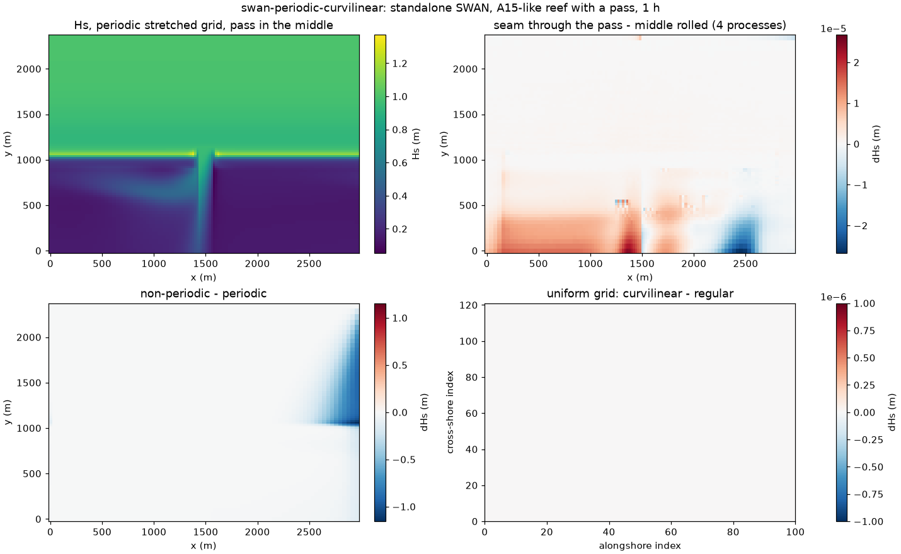

# swan-periodic-curvilinear.patch: periodic (REPEATING) curvilinear SWAN grids

| | |
|---|---|
| **Type** | improvement (new capability) |
| **Changes results?** | new: SWAN runs on periodic curvilinear grids, which it refused before; regular periodic and non-periodic grids are unchanged, except `FORCE` output at the seam of regular periodic grids (corrected) |
| **Default** | on; used when a curvilinear grid's `COORDINATES` line says `REPEATING` |
| **Files** | `SWAN/src/swanpre1.ftn`, `swancom5.ftn`, `swanser.ftn`, `swanout1.ftn`, `swanmain.ftn`, `swmod1.ftn` (`periodic_curvilinear`) |
| **Evidence** | standalone SWAN on an idealized reef with a pass: a uniform grid given as curvilinear reproduces the regular grid bit for bit; moving the seam through the pass changes Hs by 3e-5 m (stretched grid) and 1.3e-4 m (Reef_Ideal_A15's grid), against 1.2 m for a non-periodic grid; 4 processes = 1 |
| **Test** | [`tests/improvements/swan-periodic-curvilinear/run.sh`](../../../../tests/improvements/swan-periodic-curvilinear/run.sh), see its [README](../../../../tests/improvements/swan-periodic-curvilinear/README.md) |
| **Generated by** | [`generators/make_swan_patches.py`](../generators/make_swan_patches.py) |
| **Upstream** | not reported yet |

## In short

A periodic (cyclic) boundary joins the two ends of a domain: waves leaving
through one side come back in through the other. For a stretch of coast
that repeats alongshore, such as an idealized reef with regularly spaced
passes, it removes the side walls and their shadow, so the model needs only
one repeat of the coast. ROMS and SWAN both support it, but SWAN only on
regular (rectangular, uniform) grids: on a curvilinear grid it stopped with
"Curvilinear grid cannot be REPeating". COAWST couples ROMS and SWAN on the
same grid, so a ROMS grid that is stretched (finer over a reef crest or a
pass) could not have a periodic SWAN.

The patch makes `REPEATING` work on curvilinear grids. The wrap-around is
already done in index space (the neighbour of the last column is the first)
and needs no change. What needs the period is every place where SWAN takes
differences of neighbouring coordinates across the seam, where the last
column and the first lie a whole period apart, and the search for output
locations.

| Part | What it does |
|---|---|
| input | `READGRID COORDINATES` reads one more column than the grid has, column 1 shifted by one period; the period vector is that column minus column 1, and must be the same in every row (otherwise SWAN stops) |
| stencil geometry | the upwind distance across the seam has the period added (`SWGEOM`; `SPREDT` for the `CURV` numerics option) |
| `FORCE` output | the same for its x-derivatives (`SWOEXF`); this also corrects `FORCE` at the seam of regular periodic grids |
| output locations | `FRAME`, `POINTS`, `CURVE` points are found anywhere along the periodic direction: in the mesh across the seam, and whole periods away (`CVMESH`, `NEWTON`, `SINCMP`) |



*Standalone SWAN, A15-like reef with a 200 m pass, waves from 20 deg east of
north, after 1 h. Top left: Hs on the periodic grid stretched in both
directions (20 m columns at the pass, 40 m half a period away). Top right:
the same reef with the seam running through the pass, minus the top left
run shifted by half a period, on 4 processes: at most 2.7e-5 m. Bottom left:
without `REPEATING`, the side wall shadows the east side by up to 1.2 m.
Bottom right: a uniform grid given to SWAN as curvilinear, minus the same
grid as regular: zero everywhere.*

## Background: periodic grids in SWAN

`COORDINATES CARTESIAN REPEATING` makes SWAN's x-direction periodic. SWAN
stores the grid without a duplicate column: `mxc` points per row, and the
neighbour of column `mxc` is column 1. Its sweeps (SWAN solves the wave
action balance by sweeping the grid in four directions) then carry waves
across the seam as across any other mesh.

On a regular grid the spacing is a constant `dx`, so the geometry across the
seam is the same as anywhere. On a curvilinear grid SWAN uses the
coordinates of each point: the distance to the upwind neighbour is
`x(i) - x(i-1)`. Across the seam that is `x(1) - x(mxc)`, which is minus
(one period minus one mesh) instead of one mesh. SWAN 41.51 avoided the
problem by refusing the combination.

## periodic_curvilinear: the change

**Input.** With `REPEATING`, `CGRID CURVILINEAR mxc myc` has `mxc` points per
row (as for regular grids: `mxc` meshes per period), and `READGRID
COORDINATES` reads `mxc + 1` columns, the last being column 1 shifted by one
period: the same file one would write for the non-periodic grid with the
closing column. A new routine, `CVPERI`, keeps columns 1 to `mxc` and computes
the period vector `(XCPER, YCPER)` as the last column minus column 1, averaged
over the rows in double precision (a single-precision sum was off by 1 cm on
a 111-row grid with a 6 km period). If any row's period differs from the
average by more than 1e-4 of the period, SWAN stops:

```
REPeating curvilinear grid: last column is not column 1 shifted by one period
```

`INPGRID ... CURVILINEAR` input files (bottom, currents, ...) may keep the
extra column too: values are taken by index, so it is ignored. For regular
grids the period vector is set from the grid as well (used by `FORCE`).

**Stencil geometry.** In `SWGEOM`, when the upwind x-neighbour of a point is
across the seam, its coordinates are shifted by one period:

```fortran
-      IF (KREPTX.GT.0) THEN
-!       repeating x-axis (only regular grids)
+      IF (KREPTX.GT.0 .AND. OPTG.EQ.1) THEN
+!       repeating x-axis, regular grid
 ...
         DX1 = XCGRID(IXCGRD(1),IYCGRD(1)) - XCGRID(IXCGRD(2),IYCGRD(2))
         DY1 = YCGRID(IXCGRD(1),IYCGRD(1)) - YCGRID(IXCGRD(2),IYCGRD(2))
+!       repeating x-axis, curvilinear grid: the upwind neighbour in x
+!       of column 1 (sweeps 1, 4) is column MXC shifted back by one
+!       period, that of column MXC (sweeps 2, 3) column 1 shifted on
+        IF (KREPTX.GT.0) THEN
+          IF ((SWPDIR.EQ.1 .OR. SWPDIR.EQ.4) .AND. IXCGRD(1).EQ.1) THEN
+            DX1 = DX1 + XCPER
+            DY1 = DY1 + YCPER
+          ELSE IF ((SWPDIR.EQ.2 .OR. SWPDIR.EQ.3) .AND.
+     &             IXCGRD(1).EQ.MXC) THEN
+            DX1 = DX1 - XCPER
+            DY1 = DY1 - YCPER
+          ENDIF
+        ENDIF
```

`SPREDT` (spectral propagation with the `CURV` numerics option) gets the same
correction.

**`FORCE` output.** `SWOEXF` computes the wave force from x- and
y-derivatives of the radiation stress, with the same neighbour differences;
across the seam they now use the period. Regular periodic grids had the same
jump at the seam (their `FORCE` used the coordinate arrays too); with a pass
on the seam the stock error was 1.27 N/m2 there (2026-10-21). This is the
only change to regular grids.

**Output locations.** For output away from the grid points (`FRAME`,
`POINTS`, `CURVE`), SWAN finds the mesh that contains each point (`CVMESH`,
by Newton iteration in `NEWTON`). A new wrapper also tries the point shifted
by whole periods, `NEWTON` also searches the mesh between column `mxc` and
column 1 + period, and the fractional column is returned in `0 <= XC < mxc`,
as for regular periodic grids; `SINCMP` accepts such points.

**Not periodic** (as on regular periodic grids; unchanged): SWAN's own
`SETUP` and `DIFFRACTION`, and obstacles across the seam.

## How the test works

`tests/improvements/swan-periodic-curvilinear/run.sh`
([README](../../../../tests/improvements/swan-periodic-curvilinear/README.md))
runs standalone SWAN for 1 h on an idealized reef with a pass (the A15
cross-shore profile, a 200 m wide, 10 m deep pass, Hs 1 m, Tp 10 s from 20
deg east of north, so the waves cross the seam), on 12 setups:

| Case | Grid | What it checks |
|---|---|---|
| `uni-reg-mid`, `uni-crv-mid` | uniform 20 m, regular / the same as curvilinear | the curvilinear path reproduces the regular one |
| `str-mid` | stretched both ways like A15 (20-40 m alongshore, 3 km period; A15's cross-shore rows) | the main case |
| `str-seam` | `str-mid` rolled by half a period: the seam through the pass and the finest columns | must equal `str-mid` rolled back |
| `str-flat`, `uni-reg-flat` | no pass, with `FORCE` | every column the same, also at the seam |
| `str-norep` | `str-mid` without `REPEATING` | that the periodic boundary matters |
| `str-search` | `str-mid` with a `FRAME` over two periods and `POINTS` in the seam mesh and periods away | output location search |
| `str-badper` | closing column not column 1 shifted by a period | SWAN must stop |
| `a15-mid`, `a15-seam`, `a15-norep` | Reef_Ideal_A15's own SWAN grid (202 x 111, 6061 m period) | the same on a real case's grid |

Each runs on 1 process; five also on 4 processes. Without the patch, `str-mid`
(stock SWAN must refuse it) and the three cases that do not need the patch
(`uni-reg-mid`, `uni-reg-flat`, `str-norep`).

## Engine test results

Run 2026-10-31 on the control VM. PASS.

| Check | Result |
|---|---|
| stock SWAN, periodic curvilinear grid | stops: "Curvilinear grid cannot be REPeating" |
| uniform grid, curvilinear vs regular (Hs, Dir, dissipation) | identical, bit for bit |
| seam through the pass vs rolled, stretched grid, 1 and 4 processes | 2.7e-5 m |
| the same on Reef_Ideal_A15's grid and bathymetry | 1.3e-4 m (in the lagoon) |
| 4 processes vs 1, Hs (five runs) | identical |
| non-periodic vs periodic (side-wall shadow) | 1.16 m (stretched), 1.17 m (A15 grid) at the crest |
| flat reef, Hs range along a row | 9e-6 m uniform grid; 2.2e-3 m stretched (see below) |
| `FRAME` over two periods (8822 points) | none missing; the second period an exact copy of the first; in the seam mesh within 6.7e-7 m of the interpolated grid output |
| `POINTS` in the seam mesh and 1 and 2 periods away | all found; copies equal; equal to the interpolated grid output within the 3 decimals the table prints |
| closing column not a shifted column 1 | stops: "last column is not column 1 shifted by one period" |
| without vs with the patch: regular periodic, curvilinear non-periodic | identical (Hs, Dir, dissipation) |
| without vs with the patch: `FORCE` on the regular periodic flat reef | differs only in the two seam columns |

The seam residuals (2.7e-5 m, 1.3e-4 m) are SWAN's iteration error where the
sweep order meets the seam, the same on regular periodic grids; an error in
the geometry across the seam would show at the 0.1-1 m level in this test.

**Alongshore stretching itself, not the seam:** on the flat reef the
stretched grid gives Hs varying by 2.2e-3 m along the crest (Hs 1.1 m,
0.2 %), larger where the mesh is finer. It is the same on a non-periodic
grid three periods wide (2026-10-21: 0.95e-3 m in the middle period against
0.95e-3 m periodic, at normal incidence) and absent with uniform alongshore
spacing. So it is how SWAN's scheme responds to varying alongshore spacing,
independent of the periodic boundary.

## Limits found on the way (stock SWAN, not changed here)

- **`FORCE` with several processes** left out the rows at the boundaries
  between the processes' strips (exception values there, e.g. rows 19, 38
  and 57 of 76 with 4 processes), on regular grids too, periodic or not.
  Fixed since by `1-fixes/swan-force-strip-rows`: with it in the series,
  `FORCE` on 4 processes equals 1 process here (`str-flat`, `uni-reg-flat`,
  2026-10-31).
- **Merging `FRAME` output from several processes** crashes on any
  curvilinear grid, so the output search test runs on one process. Not fixed.

## Who is affected

Anyone who wants a periodic SWAN on a curvilinear grid, which includes every
coupled COAWST run with a stretched periodic ROMS grid. Regular periodic and
non-periodic runs are unchanged except `FORCE` output at the seam of a
regular periodic grid, which is now correct.
